  
  
  

 

<code>( 00 — MANIFESTO )</code>

> Eu desenho interfaces que as pessoas **sentem antes de entender**, escrevo o código que faz elas ganharem vida e cuido do SEO que coloca tudo isso na primeira página do Google.
>
> Design, código e busca: três ofícios e uma obsessão só, **experiências que ninguém esquece.**

 
 

<code>( 01 — MINHA HISTÓRIA )</code>

### Cinco capítulos, mais de cinco anos.

Hoje cuido da evolução da plataforma de cursos corporativos **Boompe**, na **Aprenda Certo**, lado a lado com back-end e QA. Em paralelo, crio landing pages e sites de alta conversão para a **Ideal Marketing Médico** e a **Agência Empreenda**, com SEO on-page, **GEO** (otimização para buscas com IA) e Core Web Vitals sempre no verde.

 

<code>( 02 — LAYOUTS )</code>

### Telas que eu desenhei e dei vida.

Do wireframe ao pixel final no Figma, pensados para converter e para ranquear. **[Ver todos os layouts no portfólio →](https://israeldev-pi.vercel.app/#layouts)**

 

<code>( 03 — O QUE EU FAÇO )</code>

### Três ofícios, um só perfil.

 

<code>( 04 — STACK )</code>

### Ferramentas do dia a dia.

+ GSAP, Lenis, Gulp, Elementor, Google Analytics e Search Console

 
 

<code>( 05 — CONTRIBUIÇÕES )</code>

### O que eu ando commitando.

<picture>
  <source media="(prefers-color-scheme: dark)" srcset="https://raw.githubusercontent.com/IsraelVictorZ/IsraelVictorZ/output/snake-dark.svg" />
  <source media="(prefers-color-scheme: light)" srcset="https://raw.githubusercontent.com/IsraelVictorZ/IsraelVictorZ/output/snake-light.svg" />
  
</picture>

 
 

  Banners em SVG animados à mão, com a mesma identidade do <a href="https://israeldev-pi.vercel.app/">israel.dev</a> ✦ feito em São Paulo

